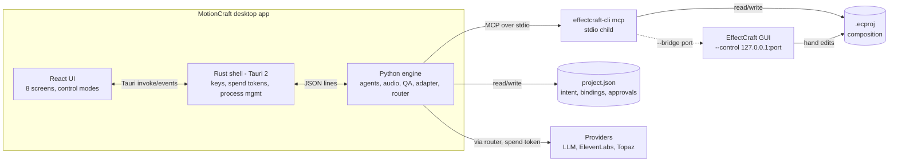

# Architecture

MotionCraft directs; EffectCraft holds the composition. Four processes, one source of truth per kind of data.



## Processes

| Process | Language | Owns | Started by |
| --- | --- | --- | --- |
| UI | TypeScript/React | Screens, Intent card, rule table, review player | Tauri |
| Shell | Rust | OS keychain, `confirm_spend` tokens, child processes, file dialogs, autosave timer | OS |
| Engine | Python 3.11 | Agents, router, adapter, audio analysis, QA, project store | Shell (sidecar, as FilmCrafter3) |
| EffectCraft MCP | Rust (external) | All composition reads/writes, renders | Engine, through the adapter only |
| EffectCraft GUI | Rust (external) | Hand edits | User, via "Open in EffectCraft" (starts it with `--control` on a free port) |

Why the adapter is in Python: the agents that issue commands live there (as in FilmCrafter3's engine), so locks are
enforced next to the caller with no extra hop. The UI never talks to EffectCraft directly. See ADR-0003.

## Repository layout (target)

```
MotionCraft/
  AGENTS.md  CLAUDE.md  README.md
  docs/                       PRD, contracts, backlog, ADRs, PORT_LEDGER.md
  schemas/                    JSON Schema: project, primitive, adapter commands (source of truth; TS + Python types generated)
  src/                        React UI (ported shell from FilmCrafter3)
    screens/ Projects Brief Intent Direction Treatment Build Review Deliver
  src-tauri/                  Rust shell
  engine/
    effectcraft.lock          pinned EffectCraft commit + expected CLI version
    motioncraft_engine/
      adapter/                base.py (interface), effectcraft.py (real), mock.py (tests), hashing.py, locks.py
      agents/                 director.py builder.py qa.py  (+ skills/)
      intent/                 card.py rules.py rules_default.yaml
      style/                  families/*.yaml conflicts.py references.py
      primitives/             library/*.yaml recipes.py render_refs.py
      audio/                  analysis (vendored or package), markers.py, sync.py
      router/                 llm.py sound.py enhance.py capabilities.py spend.py
      qa/                     tier1/*.py findings.py
      store/                  project.py package.py revisions.py index.py (SQLite)
      safe.py safeio.py
    tests/                    pytest; marker `real_engine` for EffectCraft-backed tests
  e2e/                        Playwright
  golden/                     10 golden briefs + reviewer score sheets
```

## Data ownership

| Data | Lives in | Never in |
| --- | --- | --- |
| Comps, layers, keyframes, effects, markers | `.ecproj` | `project.json` |
| Brief, intent, style profile, treatment | `project.json` | `.ecproj` |
| Layer role, primitive, provenance, lock, approved hash | `project.json` → `layerMap` (keyed by EffectCraft layer id) | — |
| Approvals, revisions, renders, QA reports | `project.json` | — |
| Search and history index | local SQLite (`index.db`, rebuildable from the package) | the package |
| Keys | OS keychain | anywhere on disk |

## Main flows

**Agent edit.** Builder plans → shows plan, layers, models, cost → (approval if paid) → adapter checks targets
against `layerMap` locks → `command_batch` over MCP → adapter re-hashes changed layers → store writes a revision with
provenance → UI refreshes preview via `render_preview`.

**Hand edit.** User clicks "Open in EffectCraft" → shell starts the GUI with `--control <port>`; the engine switches
the MCP child to `--bridge <port>` so agent edits land in the live document → user edits and saves → on save or
refocus the adapter `hashLayers` → any differing hash becomes a user revision; a differing hash on an approved
layer marks that approval "changed by user" (never reverted).

**Final render.** Gate D sheet shows cost and settings → user confirms → shell mints a spend token → engine queues
`renderQueue.add` + `renderQueue.render {wait:true}` → resume from last good frame on interruption.

## Cross-cutting

- **Confinement:** MCP child runs with read/write roots = package folder + asset cache.
- **Autosave:** every 30 s and on each gate; writes `project.json` atomically (temp + rename) and asks EffectCraft
  to save only when the agent made the last change (never save over an unsaved hand edit in the GUI).
- **Offline:** every provider declares `offline: bool`; the router refuses cloud providers in offline mode.
- **Observability:** every adapter call and provider call is a JSON line in `logs/session-*.jsonl` (no keys).
