# Walkthrough: Civilization I–VII, from script to video

This is a real run of the built MotionCraft app (Windows, EffectCraft 0.24.1, a local language model, no paid calls), from an empty project
to a 90-second, 21:9 film with sound. Every picture below is a screenshot of the app taken by `scripts/walkthrough_civilization.py`.
You can open the finished project in the app (Projects, **Open the example**) and look at every page for yourself.

**What went in:** the script and the on-screen text table exactly as written ([docs/stress-test/civilization-script.md](../stress-test/civilization-script.md)),
ten pictures (one per shot, 1911 × 819), and a placeholder score made from plain tones (`scripts/make_civilization_score.py`).
**What came out:** a 2560 × 1080, 24 fps H.264 file with stereo AAC sound, and a project you can reopen and edit in MotionCraft or EffectCraft.

A note on honesty: native file dialogs cannot be driven by a script, so the pictures and the score were added by sending the app the same
"files dropped on the window" event the operating system sends. Everything else was clicked and typed in the app.

## 0. First run

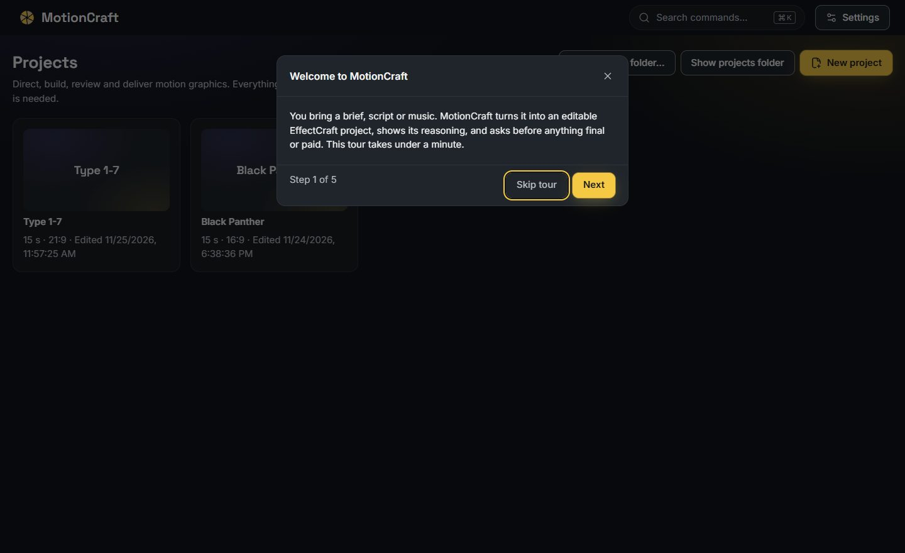

A short tour opens the first time. It can be skipped, and replayed from the command palette (Ctrl+K, "Take the tour").

## 1. Start a project

Name, aspect (21:9 here), resolution, frame rate and length. The size follows from the aspect and the resolution.

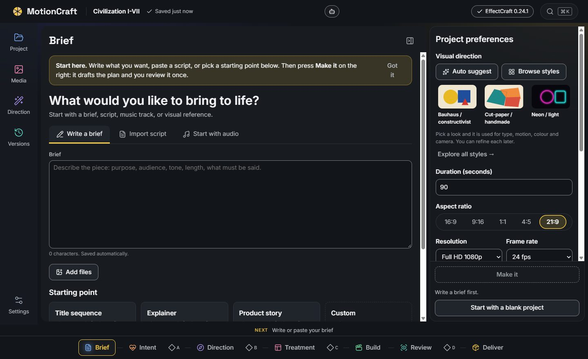

## 2. Paste the script

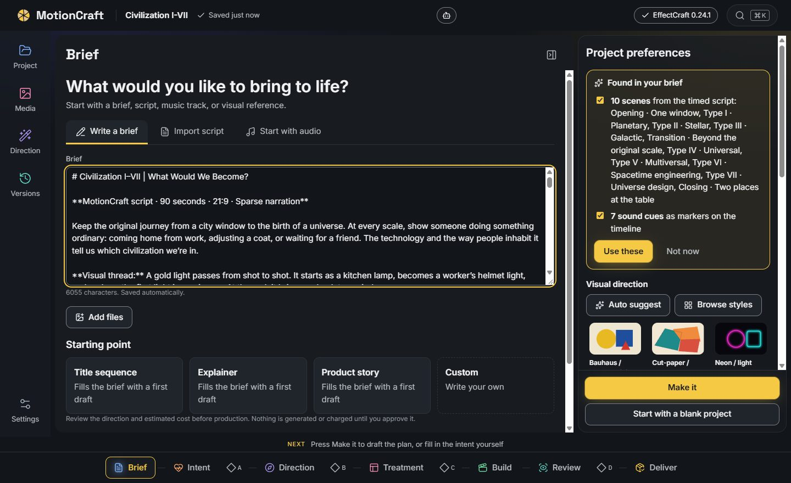

The script is pasted as written: two tables, one for the shots and one for the on-screen text and its timing. MotionCraft reads the tables by
their headings, joins the shot's name and what we see, takes the voiceover as the sound, and uses the second table for the text.

"Found in your brief" lists what it understood: ten scenes with their names, and the voiceover lines as markers. Nothing is applied until you press **Use these**.

## 3. Add the pictures (and the sound)

Drag pictures, video or audio onto the window. A drop target appears, the files are checked by their real type, and they are copied into the project.

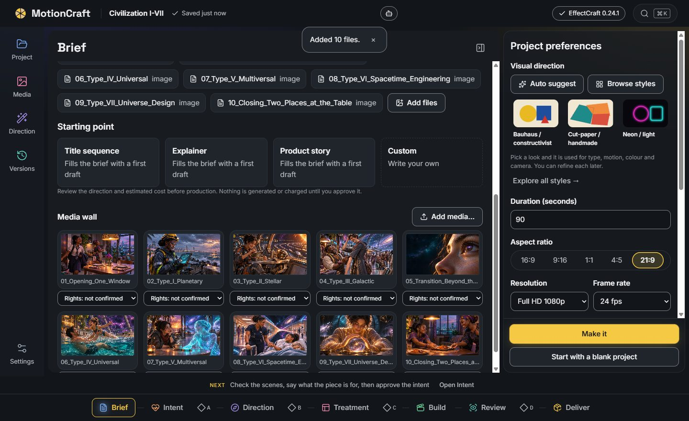

Each imported file has a rights note ("I made it or own it", "Licensed to me", "Stock or free licence"), because MotionCraft cannot know a file's licence. QA asks about any that are blank.

The score is added the same way. MotionCraft analyses it (beats, sections) and draws it under the timeline.

## 4. Make it

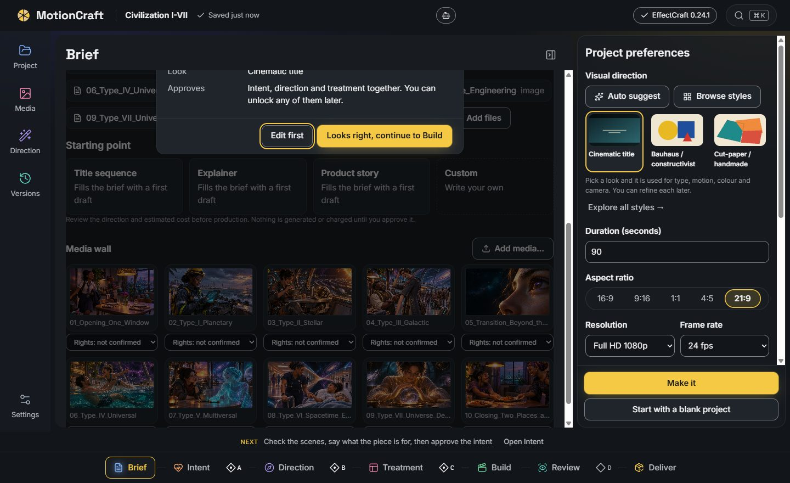

One button. The local model drafts the intent (what the piece is for, its tone, one scene per row of the script), a look is chosen, each scene's plan comes
from the script, and the ten pictures are given to the ten scenes in order. You review it once. This screenshot is the plan; we chose **Edit first** to show every page.

## 5. Intent, direction, treatment: three approvals

The Intent page is the interpretation everything else follows. Here we changed the purpose to *Inform* and swapped *Playful* for *Restrained*.

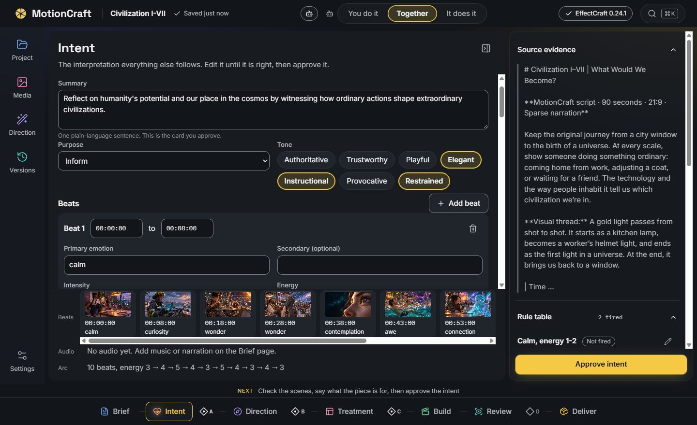

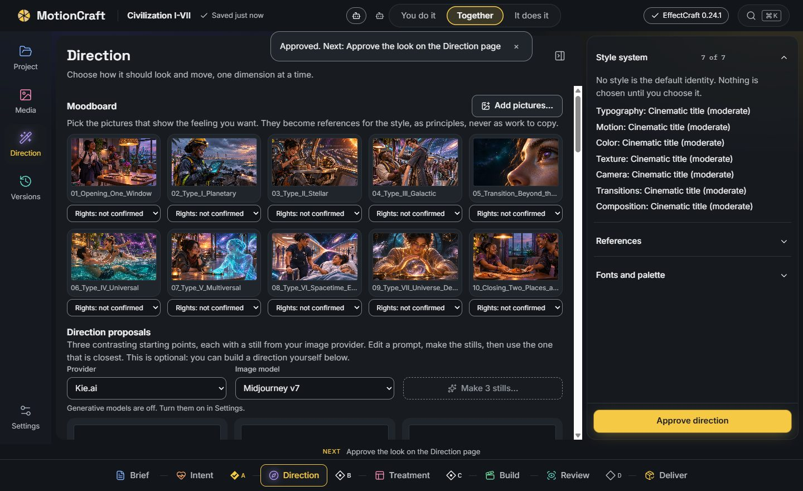

Approving takes you to the next page and says what to do there. Approval is always your click.

Direction sets seven dimensions (typography, motion, colour, texture, camera, transitions, composition). We kept *Cinematic title* and made the typography *Swiss / International*.

There are 42 style presets in four groups, with filters.

Treatment is a storyboard: one picture and one plan per scene. Each picture can be replaced, or made with an image provider (always after a confirmation that shows the price).

## 6. Build

The Builder plans the layers. The on-screen text is **timed to the script's rows**, whatever the model guessed: each line appears on its row, fades in and out, sits in the lower
third so the picture stays clean, and the SPECULATIVE tag sits under Types IV–VII as its own small layer. Every layer has a tick box: leave out what you do not want.

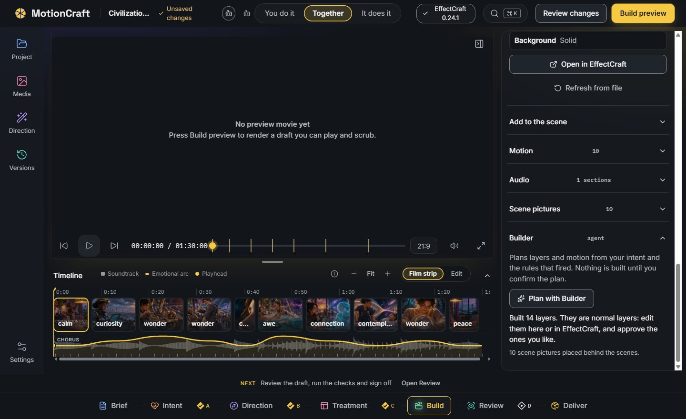

One click builds the layers, puts the pictures behind their scenes (fitted to fill the frame, dimmed a little), and adds the score so the render is not silent.

**Build preview** renders a draft you can play and scrub.

## 7. Review: checks, notes, versions, sign-off

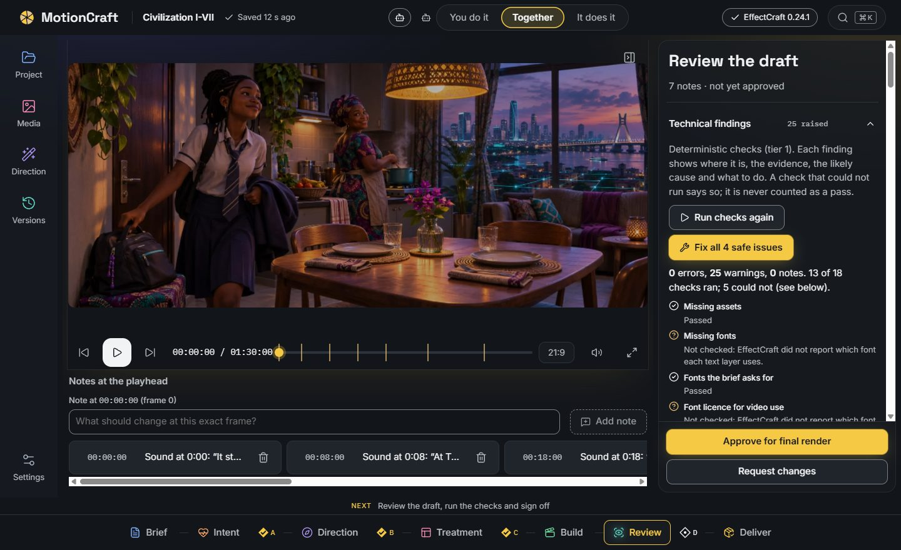

Eighteen checks run. This first run found real things: ten pictures enlarged to 134% (they are 1911 px wide in a 2560 px film), and eleven imported files with no rights note.
Checks that cannot run say so and give the reason; they are never counted as passes.

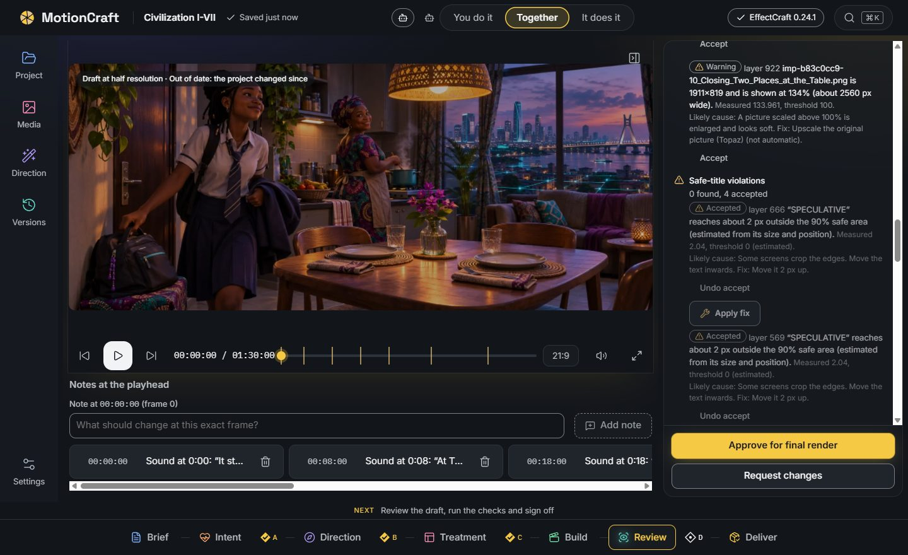

A warning can be **accepted** (you looked, you keep it); it stays listed and stops counting. Errors cannot be accepted.

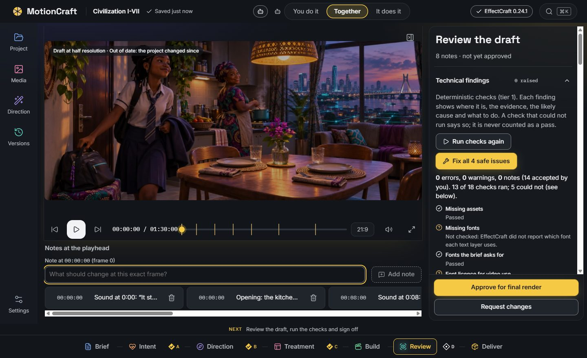

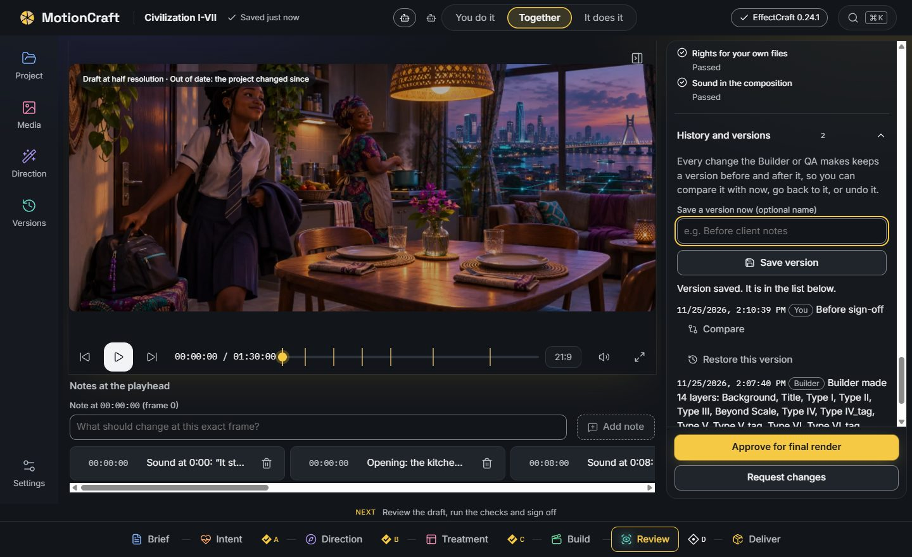

Notes are pinned to a frame. Every automatic change keeps a version before and after it, so it can be compared or undone.

## 8. Deliver

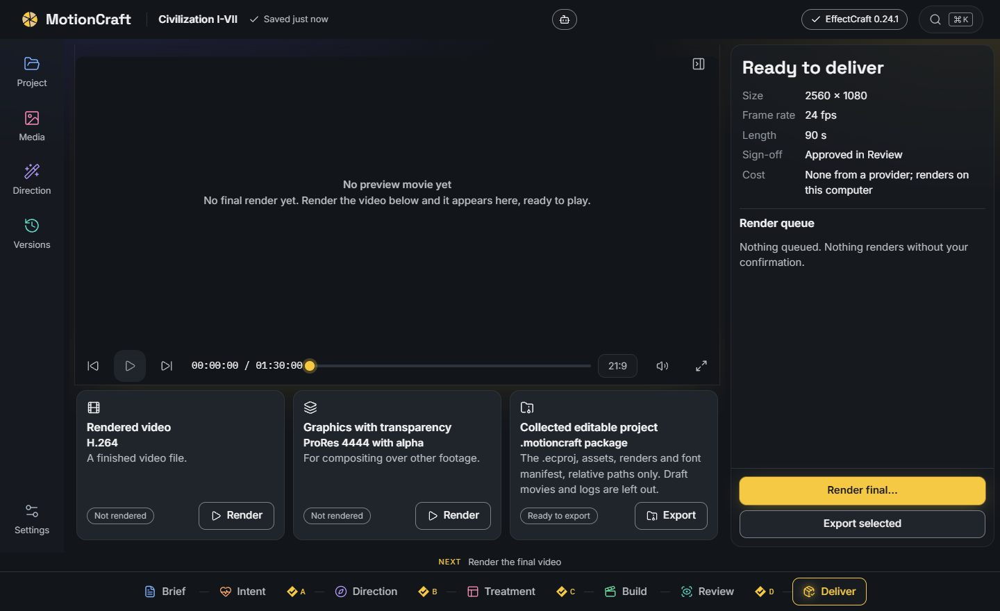

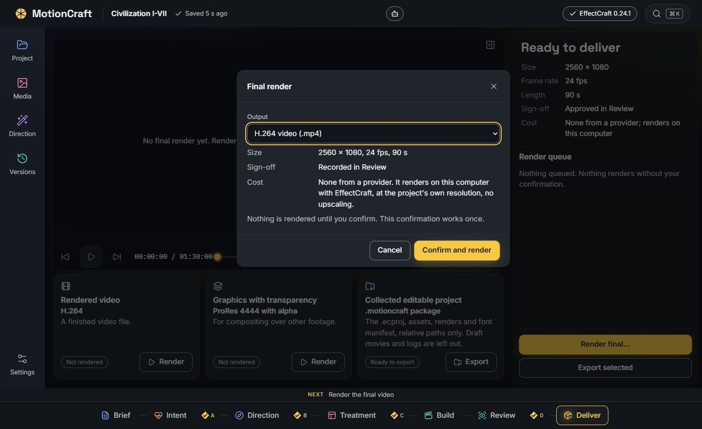

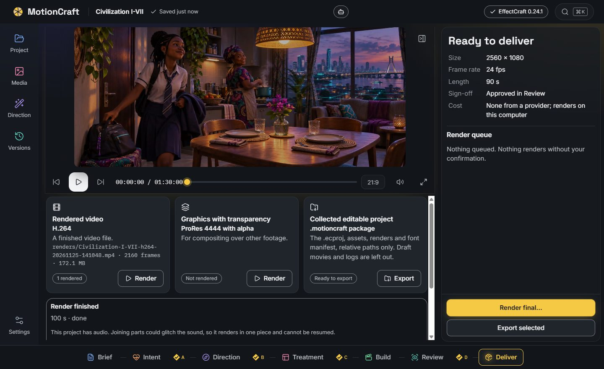

The final render asks first, even when it costs nothing, and shows what it will make. The result is a 2560 × 1080 H.264 file with the score as stereo AAC.

## 9. Open it in EffectCraft

Everything MotionCraft builds is a normal EffectCraft composition (`comp.ecproj` in the project folder): **Open in EffectCraft** on the Build page. Layers, keyframes and text
are editable there, and **Refresh from file** brings your changes back.

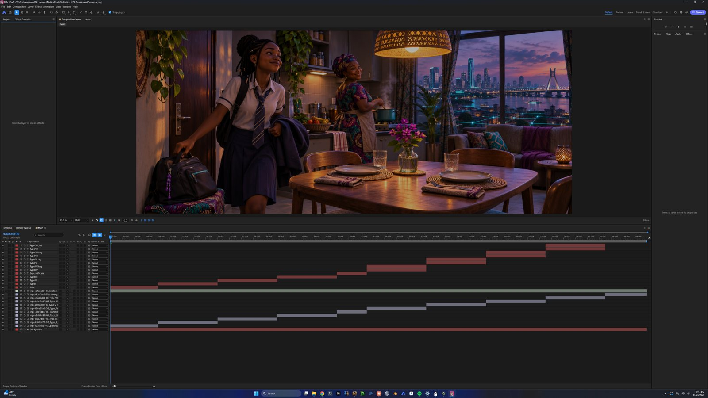

The text labels step across the timeline in their rows, the ten pictures sit under them in the same steps, the score runs the full length, and the background is at the back.
While EffectCraft has the project open MotionCraft is read-only; close EffectCraft and MotionCraft reloads the project and logs what you changed.

## The example inside the app

A copy of this finished project (without its final render) ships with MotionCraft. On the Projects page press **Open the example**: it is copied into your projects folder, so you can change it freely.

## What this run found and fixed

The run is also the stress test. See [docs/stress-test/FINDINGS.md](../stress-test/FINDINGS.md) for the list, with the tests that now guard each fix.
