# QuickPath: your first video, step by step

A walkthrough for first-time users, with pictures from the real app.

## Before you start

QuickPath turns an idea (or a timed script) into a finished video on your own computer. You do not need any account to start: the scenes, free voices, music and your own pictures cost nothing.

You need **Windows 10 or 11** and **EffectCraft** (the program that draws and saves the video). QuickPath finds EffectCraft by itself; the small green badge at the top says **EffectCraft ready** when it has.

AI pictures, voices, music and animated clips are optional extras. They use your own accounts and always ask the price first (see step 8).

## 1. Install and open

Run `QuickPath_0.2.0_x64-setup.exe` and open QuickPath from the Start menu. Windows may say **unknown publisher** because the installer is not signed yet: choose **More info**, then **Run anyway**.

QuickPath keeps everything in your **Documents\QuickPath** folder: one folder per video, a `spend.jsonl` file that counts anything you pay for, and your settings.

## 2. Say what your video is about

Type a sentence or a paragraph. Or press one of the **Try** buttons to see an example.

Pick a **length** (10, 15, 30 or 60 seconds) and a **shape**: wide (16:9), tall (9:16), square, portrait (4:5), cinema (21:9) or classic (4:3). Each shape is drawn to scale.

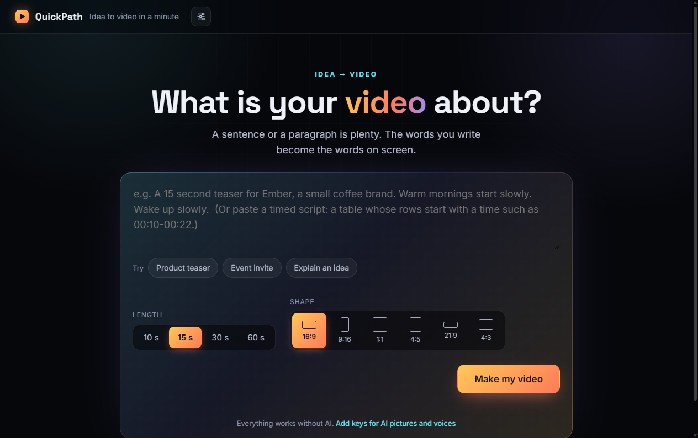

*The start screen. Type or paste your idea; the words you write become the words on screen.*

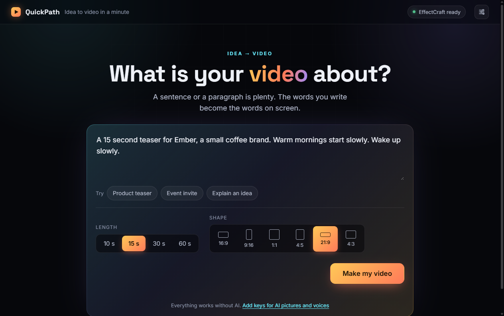

*An idea typed and the Cinema shape chosen. Press **Make my video**.*

## 3. Your video appears

In a few seconds you have a finished first video. Press play. Under it the **scene bar** shows each scene as long as it lasts; the line moves as the video plays.

Nothing is final yet: change anything and press **Update video** to see it again (about ten seconds).

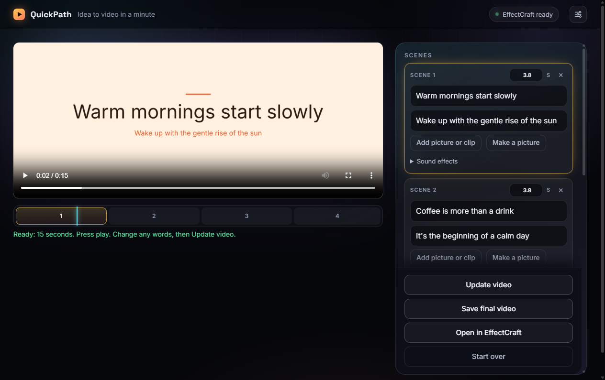

*The studio: the video on the left, your scenes on the right, and the buttons at the bottom.*

## 4. Change the words and the timing

Click a scene's words to rewrite them. The number at the top of a scene is its length in seconds. **×** removes a scene; **Add a scene** (lower down) adds one.

Press **Update video** whenever you want to see your changes.

*Each scene has its words, a small line, how many seconds it lasts, and places to add a picture.*

## 5. Add pictures and clips

**Add picture or clip** puts your own PNG, JPEG or MP4 behind a scene's words. **Make a picture** asks an AI model for one (a price window appears first).

**References** (below the scenes) is a shelf of pictures for the whole video: characters, places, props. Choose a sheet with several panels, say how many go **across** and **down**, trim any title or caption band, name the panels and press **Cut into pictures**. Then pick **Use a reference** on any scene.

For characters that look the same in every scene, open **Characters and places** on a scene, pick the reference pictures of who and where is in it (Tami, the kitchen), and press **Make a picture with these** (about $0.02): the picture is made from your references. Then animate it.

A scene with a picture can also get **Animate this picture**: an AI clip of about five seconds. The **Motion** panel shows what is still needed to fill each scene, what the film has cost so far, and makes the missing clips on one confirmation. **Continue this clip** starts the next clip from the last frame of the one before, so the shot carries on. Under each scene, **Check the clips** shows frames from every clip so you can discard one you do not like.

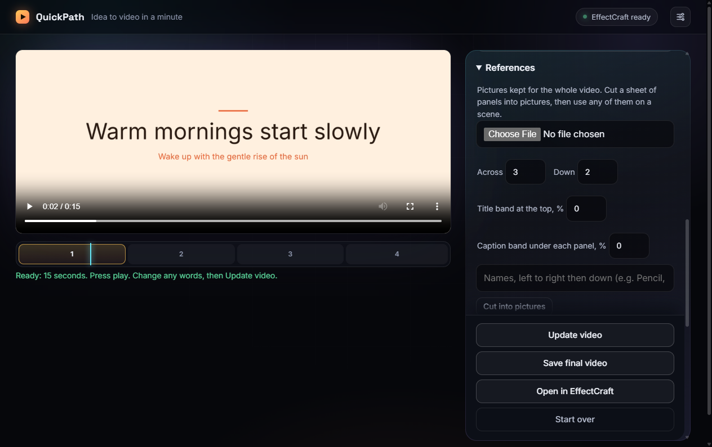

*The References shelf: pictures kept for the whole video, and a way to cut a sheet of panels into separate pictures.*

## 6. Voice and music

**Voiceover**: the free Windows voices need nothing. If you add keys (step 8) you also get Kie.ai, ElevenLabs, Voicekiller and OpenAI voices. Each scene can have its own **Speaker**, so a character can sound different from the narrator.

**Music**: four built-in moods are free. **Make with AI (Suno, paid)** makes a track as long as your video. Or use your own sound file. Music dips by itself under the voice, and every voice is brought to the same loudness.

**Sound effects**: each scene has a list of small built-in effects (pencil scratch, match strike, switch clack and more) that you can switch on. They are simple synthesised sounds, not recordings.

Scenes get longer by themselves when a voice needs more time.

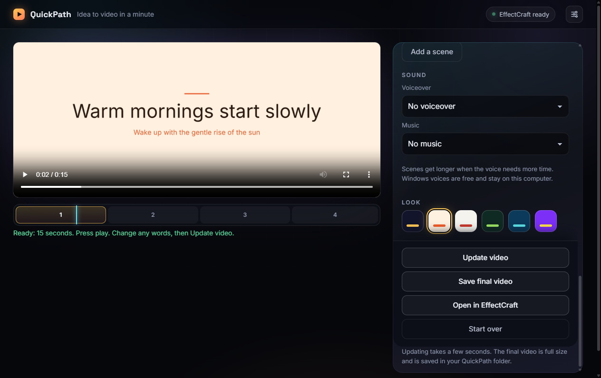

*Voice, music and look are at the bottom of the scene list.*

## 7. The price window

Every paid action shows this window first: what will be made, by which service, an estimated price, how much you have already used of your limit, and the exact words that will be sent. You can change the words.

A confirmation is used once, for that one thing. When a service bills through your own plan (ElevenLabs, Voicekiller) the window says so.

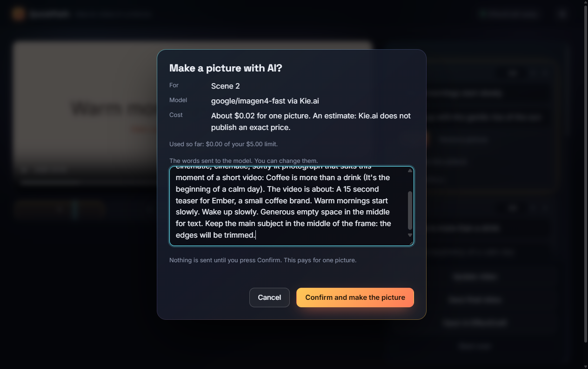

*Nothing paid happens until you press Confirm. Cancel sends nothing.*

## 8. Settings and keys

Paste a key into its box, press **Save key**, then **Check it works**. Keys are kept in Windows Credential Manager and never shown again.

**Kie.ai** (pictures, voices, music, clips), **ElevenLabs** (your own voices; paste the key), **Voicekiller** (two boxes: your User ID and your API key), **OpenAI** (voices), **fal** (not used yet). The full guide to getting each key is `SETUP_KEYS.md`.

The **spending limit** (default $5) is a hard stop: QuickPath refuses anything that would pass it. You can change it here.

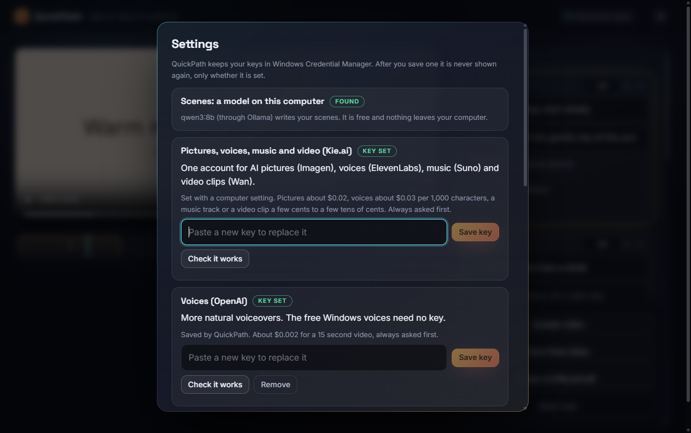

*The sliders button at the top right opens Settings: keys for each service, and your spending limit.*

## 9. Start from a script

If you have a script, paste it in the start box, press **Open a script file** under it (PDF, Word or text), or choose **File, Open a script** in the desktop app. Two kinds work: a **timed table** (a time column, the picture and motion, and the voice-over and sound; a sample is in `samples/the-day-we-built-superintelligence.md`) and a **scene script** with no times, written as `SCENE 1 — TITLE` blocks (a music-video or screenplay style script). Everything is read on your computer; nothing is sent anywhere.

For a timed table QuickPath makes one scene per row, as long as its time range. For a scene script it makes one scene per SCENE heading, with no words on screen, the scene's action as its direction, and lengths of about 15 seconds each that you can change. If you have the song, add it under **Music**, **My own sound file**, then press **Fit scenes to the music**: the scene lengths are stretched to match the song. Time cards (such as DAY ZERO) appear small and low in the frame; the quoted voice-over is what is spoken; a speaker other than the narrator gets a second voice; the picture direction is kept for each scene; and sound notes switch on matching effects.

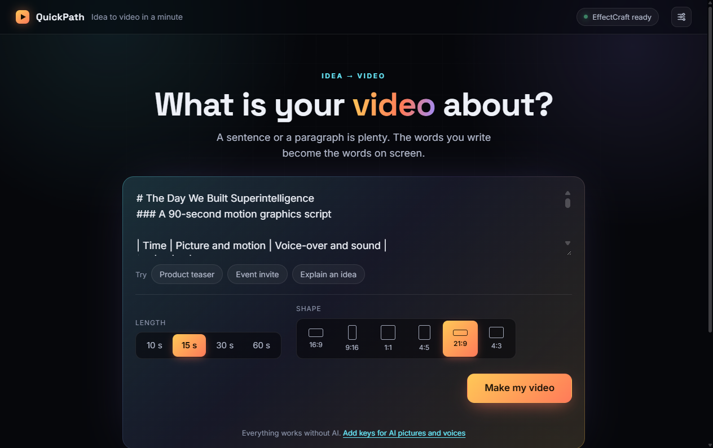

*Paste a timed script: a table whose rows start with a time such as 00:10-00:22.*

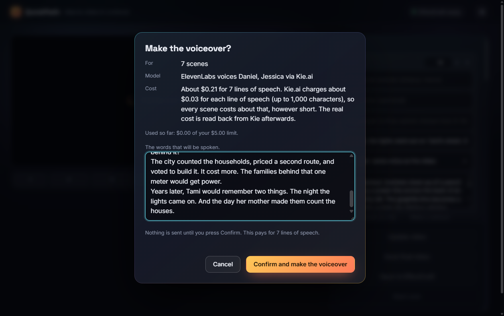

*When a voice from a paid service is chosen, Update video asks first. This script has seven lines for about $0.21.*

## 10. Check and refine the script's scenes

Give each scene a picture or clip (your own, a reference, or an AI one), pick voices, then press **Update video**.

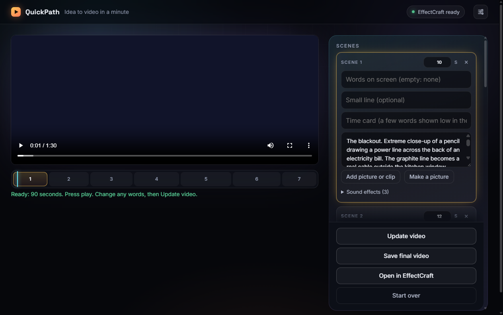

*The script's scenes, in time. Scene 1 shows the picture direction and the sound effects chosen from the script.*

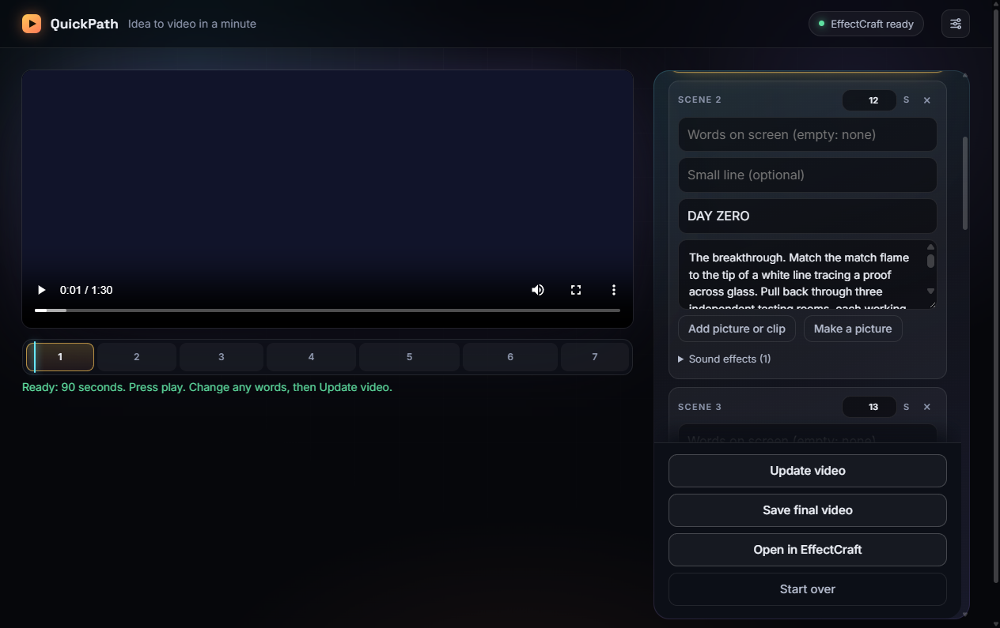

*Each scene keeps the script's words as its direction, plus a Time card, a Speaker and Sound effects.*

## 11. Save your video

**Save final video** makes the full-size version and saves it in your QuickPath folder (`final-….mp4`). **Show in folder** opens it. Updating (the quick version) is half size; the final is full size.

## 12. Open it in EffectCraft

QuickPath builds your video as a real EffectCraft project, so you can keep editing in EffectCraft. Press **Open in EffectCraft** (or **File, Open in EffectCraft**, or Ctrl+E). EffectCraft starts with your project open.

You can also open the project yourself: in EffectCraft choose **File, Open** and pick `video.ecproj` in `Documents\QuickPath\projects\<your video>`. **Show in folder** takes you to the video's folder.

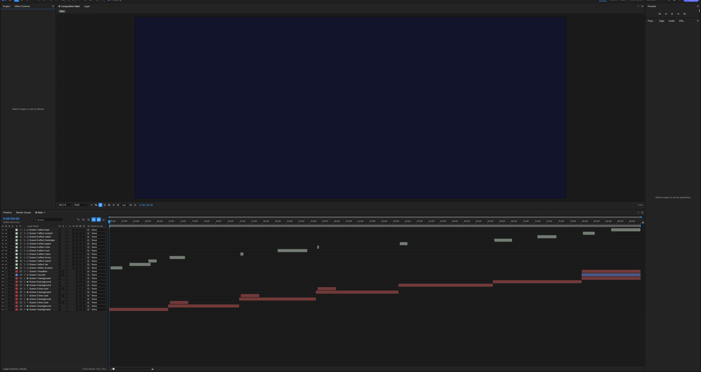

*The same video opened in EffectCraft: every scene is real, editable layers.*

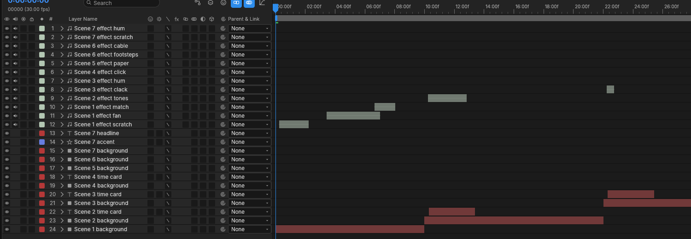

*The layers are named by scene: backgrounds, headlines, time cards, accent lines, voice, music and sound effects. Text stays real text.*

**Important:** QuickPath rebuilds `video.ecproj` every time you press **Update video** or **Save final video**, and it does not read changes back from EffectCraft. Once you start editing in EffectCraft, choose **File, Save As** and save under a new name, and stop pressing Update in QuickPath for that video.

To make the finished MP4 from your edited version, use EffectCraft's own render queue.

## 13. Menus and shortcuts

The Help menu opens this walkthrough, the user guide, the key setup guide, the plan for what comes next, how it was tested, and the signing guide.

| Menu item | Keys |
|---|---|
| New video | Ctrl+N |
| Open a script… | Ctrl+O |
| Update video | Ctrl+Enter |
| Save final video | Ctrl+S |
| Open in EffectCraft | Ctrl+E |
| Settings and keys | Ctrl+, |
| User guide | F1 |

## 14. If something goes wrong

More: `USER_GUIDE.md` (every feature), `SETUP_KEYS.md` (keys), `SIGNING.md` (installing without warnings), `QA.md` (what was tested and what was not).

| What you see | What to do |
|---|---|
| EffectCraft not found | Install EffectCraft 0.24.1, or set the `EFFECTCRAFT_CLI` computer setting to its `effectcraft-cli` program. |
| No Kie.ai (or other) key was found | Add the key in Settings. Free features keep working without it. |
| Make the voiceover first | A paid voice has not been made yet. Press Update video and confirm the price. |
| This would pass your spending limit | Raise the limit in Settings, or use fewer paid parts. |
| Open in EffectCraft says press Update first | A project is only saved after the first Update video. |
| A clip has people in it you did not ask for | AI models add people on their own. Check the frames under each scene and discard the clip. |

